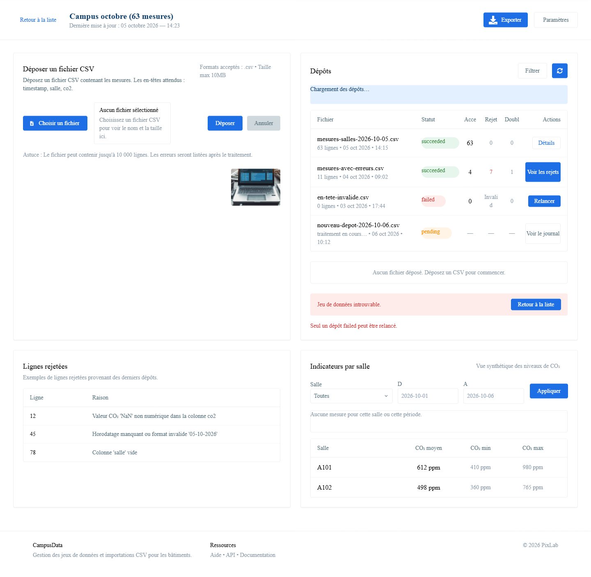

# Dossier de conception - CampusData

**Membres :** chahnez el bez  
**Version du dossier / commit :** à renseigner.  
**Date de revue :** à renseigner.  
**Relecteur :** à renseigner.

Cette trame se complète dès S1 puis évolue avec les décisions réellement prises.
Remplacer les consignes par vos réponses ; conserver les limites utiles.
Ne pas recopier tout l’énoncé : expliquer son application à votre réalisation.

## 1. Besoin et utilisateurs

### Le besoin en cinq phrases

- L'équipe data du campus utilise l'application CampusData pour suivre la qualité de l'air dans les salles.
- Aujourd'hui, les fichiers disponibles sont recopiés à la main dans un tableur, ce qui entraîne des erreurs et des doublons.
- Elle dépose un fichier de mesures dans l'application, qui vérifie chaque ligne, signale celles qui sont refusées avec la raison, puis affiche des indicateurs par salle (moyenne, minimum, maximum).
- Il faut conserver les jeux de données, l'historique des dépôts avec leur résultat, les mesures valides et les lignes rejetées avec leur motif, même après un redémarrage du service.
- Sont exclus du projet : la connexion des utilisateurs, l'intelligence artificielle et l'affichage en temps réel.

### Scénario de démonstration

1. Ouvrir l'application sans aucun jeu de données.
2. Créer un jeu de données (« Campus novembre ») et vérifier qu'il apparaît dans la liste avec 0 mesure.
3. Déposer `mesures-avec-erreurs.csv` et attendre que le statut passe de `pending` à `succeeded`.
4. Lire le résultat : 4 mesures acceptées, 7 lignes rejetées avec leur raison, 1 doublon.
5. Consulter les indicateurs par salle (CO₂ moyen, min, max) et les filtrer par salle ou par période.
6. Redéposer le même fichier et constater qu'aucune mesure n'est ajoutée une seconde fois.

## 2. Backlog et critères d’acceptation

Une tâche n'est terminée qu'après observation de son résultat et revue par l'autre membre du binôme.

### US01 - Créer un jeu de données

- **En tant que... je veux... afin de... :** En tant que membre de l'équipe data, je veux créer un jeu de données afin de regrouper des mesures.
- **Priorité :** Haute.
- **Critère d'acceptation :** Étant donné qu'aucun jeu « Campus octobre » n'existe, quand je le crée, alors il apparaît dans la liste.
- **Critère négatif :** Si le nom est déjà utilisé, la création est refusée avec le code 409.
- **Responsable / Preuve :** Membre A. Preuve : capture de la liste + requête qui renvoie 409.
- **Réalisation :** Permettre la création d'un jeu avec un nom unique.
- **Validation :** Créer un jeu, puis tenter de recréer le même nom et observer le 409.
- **Documentation :** Noter l'exemple de requête et les codes de réponse.

### US02 - Lister et ouvrir les jeux

- **En tant que... je veux... afin de... :** En tant que membre de l'équipe data, je veux lister et ouvrir les jeux afin de savoir ce qu'ils contiennent.
- **Priorité :** Moyenne.
- **Critère d'acceptation :** Étant donné que des jeux existent, quand j'ouvre la liste, alors chaque jeu affiche son nombre de mesures.
- **Critère négatif :** Si j'ouvre un jeu inconnu, la réponse est 404.
- **Responsable / Preuve :** Membre B. Preuve : capture de la liste + requête qui renvoie 404.
- **Réalisation :** Afficher la liste des jeux avec le nombre de mesures, et l'ouverture d'un jeu.
- **Validation :** Vérifier le compteur, puis ouvrir un jeu inexistant et observer le 404.
- **Documentation :** Noter les routes de consultation.

### US03 - Supprimer un jeu

- **En tant que... je veux... afin de... :** En tant que membre de l'équipe data, je veux supprimer un jeu afin de retirer des données devenues inutiles.
- **Priorité :** Moyenne.
- **Critère d'acceptation :** Étant donné qu'un jeu contient des mesures, quand je le supprime et que je confirme, alors le jeu et ses mesures disparaissent.
- **Critère négatif :** Si je ne confirme pas, rien n'est supprimé.
- **Responsable / Preuve :** Membre A. Preuve : capture de la confirmation + liste après suppression.
- **Réalisation :** Suppression d'un jeu avec confirmation, et de ses mesures.
- **Validation :** Annuler la confirmation (rien ne change), puis confirmer et vérifier que les mesures ont disparu.
- **Documentation :** Noter que la suppression est définitive.

### US04 - Déposer un fichier CSV

- **En tant que... je veux... afin de... :** En tant que membre de l'équipe data, je veux déposer un fichier CSV afin d'alimenter un jeu sans recopier à la main.
- **Priorité :** Haute.
- **Critère d'acceptation :** Étant donné qu'un jeu existe, quand je dépose un CSV, alors l'API répond 202 et le dépôt est enregistré avec le statut `pending`.
- **Critère négatif :** Si le jeu n'existe pas, le dépôt est refusé (404).
- **Responsable / Preuve :** Membre B. Preuve : requête curl avec réponse 202 + statut `pending`.
- **Réalisation :** Route de dépôt qui enregistre le fichier et répond 202 avec le statut `pending`.
- **Validation :** Déposer un CSV et observer le 202 ; tester un jeu inconnu.
- **Documentation :** Noter un exemple de requête curl.

### US05 - Voir le dépôt traité

- **En tant que... je veux... afin de... :** En tant que membre de l'équipe data, je veux voir mon dépôt traité afin de savoir s'il a réussi.
- **Priorité :** Haute.
- **Critère d'acceptation :** Étant donné un dépôt `pending`, quand le worker l'a traité, alors son statut est `succeeded` ou `failed`.
- **Critère négatif :** `en-tete-invalide.csv` donne `failed` avec le message « Invalid header » et 0 mesure.
- **Responsable / Preuve :** Membre A. Preuve : statut visible avant/après + résultat des 3 fichiers de test.
- **Réalisation :** Le worker traite les dépôts `pending` et fixe le statut final.
- **Validation :** Déposer les 3 fichiers de test et comparer aux résultats attendus (63 / 4-7-1 / Invalid header).
- **Documentation :** Décrire le cycle `pending` vers `succeeded` ou `failed`.

### US06 - Voir les lignes rejetées

- **En tant que... je veux... afin de... :** En tant que membre de l'équipe data, je veux voir les lignes rejetées et leur raison afin de corriger mes fichiers.
- **Priorité :** Haute.
- **Critère d'acceptation :** Étant donné le dépôt de `mesures-avec-erreurs.csv`, quand il est traité, alors 4 lignes sont acceptées, 7 sont rejetées et la raison de chaque rejet est affichée.
- **Critère négatif :** Une ligne invalide n'est jamais enregistrée comme mesure.
- **Responsable / Preuve :** Membre B. Preuve : capture de la liste des rejets (7 lignes + raisons).
- **Réalisation :** Enregistrer chaque ligne rejetée avec sa raison et les compter.
- **Validation :** `mesures-avec-erreurs.csv` donne 7 rejets, chacun avec une raison lisible.
- **Documentation :** Lister les raisons de rejet possibles.

### US07 - Redéposer sans doublon

- **En tant que... je veux... afin de... :** En tant que membre de l'équipe data, je veux redéposer un fichier sans doublon afin d'éviter de compter deux fois la même mesure.
- **Priorité :** Haute.
- **Critère d'acceptation :** Étant donné que `mesures-salles-2026-10-05.csv` a déjà été déposé, quand je le redépose, alors il y a 0 acceptée, 63 doublons et le jeu contient toujours 63 mesures.
- **Critère négatif :** Aucune mesure n'est ajoutée deux fois.
- **Responsable / Preuve :** Membre A. Preuve : résultat du 2ᵉ dépôt + compteur du jeu à 63.
- **Réalisation :** Détecter les mesures déjà présentes et les compter comme doublons.
- **Validation :** Redéposer le fichier de référence et obtenir 0 acceptée, 63 doublons, 63 mesures au total.
- **Documentation :** Expliquer ce qui définit un doublon (voir la conception détaillée).

### US08 - Consulter les indicateurs

- **En tant que... je veux... afin de... :** En tant que membre de l'équipe data, je veux consulter les indicateurs par salle afin d'analyser la qualité de l'air.
- **Priorité :** Haute.
- **Critère d'acceptation :** Étant donné un jeu avec des mesures, quand je consulte les indicateurs, alors je vois la moyenne, le min et le max du CO₂ par salle, filtrables par salle et par période.
- **Critère négatif :** Un filtre sans aucune mesure ne renvoie aucun indicateur, sans erreur.
- **Responsable / Preuve :** Membre B. Preuve : capture des indicateurs avec et sans filtre.
- **Réalisation :** Calculer moyenne, min, max par salle avec filtres salle et période.
- **Validation :** Comparer les valeurs à un calcul fait à la main sur le fichier de référence ; tester un filtre vide.
- **Documentation :** Noter les paramètres de filtre.

### US09 - Relancer un dépôt échoué

- **En tant que... je veux... afin de... :** En tant que membre de l'équipe data, je veux relancer un dépôt échoué afin de le retraiter après correction.
- **Priorité :** Moyenne.
- **Critère d'acceptation :** Étant donné un dépôt `failed`, quand je le relance, alors il est de nouveau traité.
- **Critère négatif :** Relancer un dépôt qui n'est pas `failed` est refusé.
- **Responsable / Preuve :** Membre A. Preuve : relance d'un `failed` acceptée et d'un `succeeded` refusée.
- **Réalisation :** Route de relance, autorisée seulement pour un dépôt `failed`.
- **Validation :** Relancer un `failed` (accepté) et un `succeeded` (refusé).
- **Documentation :** Noter la règle et le code de refus.

### US10 - Compter sur un service fiable

- **En tant que... je veux... afin de... :** En tant que membre de l'équipe data, je veux compter sur un service fiable afin de ne pas perdre mes données.
- **Priorité :** Haute.
- **Critère d'acceptation :** Étant donné des jeux et des mesures enregistrés, quand le service est redémarré, alors toutes les données sont toujours là.
- **Critère négatif :** Une panne ou un redémarrage ne doit pas supprimer les jeux, dépôts et mesures persistés.
- **Responsable / Preuve :** Membre B. Preuve : compteurs avant/après redémarrage.
- **Réalisation :** Stocker les données de façon persistante.
- **Validation :** Redémarrer l'application et vérifier que les compteurs sont identiques.
- **Documentation :** Noter la procédure de redémarrage utilisée pour le test.

## 3. Maquettes et interactions

### Écran 1 - liste des jeux de données

### Écran 2 - un jeu de données

## 4. Architecture et flux

### Modèle de données

### Table DATASET

- **id :** uuid, obligatoire, PK ; généré côté serveur.
- **name :** varchar(120), obligatoire, UK ; nom unique, 3 à 120 caractères après retrait des espaces externes. Un doublon est refusé avec le code 409.
- **description :** TEXT nullable, au plus 2 000 caractères ; une chaîne vide ou des espaces sont acceptés tels quels, l'interface envoie `null`.
- **owner :** varchar(60), obligatoire, nettoyé, 2 à 60 caractères ; valeur par défaut `Équipe`.
- **created_at :** TIMESTAMPTZ UTC, obligatoire, généré serveur et immuable.
- **measurement_count :** entier calculé en SQL, non stocké dans la table.
- **Relations :** un jeu reçoit ses dépôts et ses mesures ; sa suppression entraîne leurs suppressions par cascade.

### Table INGESTION

- **id :** uuid, obligatoire, PK ; généré côté serveur.
- **dataset_id :** uuid, obligatoire, FK vers `DATASET.id` avec suppression en cascade.
- **filename :** varchar(255), obligatoire, 1 à 255 caractères, sans `/` ni `\`.
- **status :** varchar(10), obligatoire ; valeurs `pending`, `running`, `succeeded`, `failed`, avec `pending` comme état initial.
- **content :** BYTEA, obligatoire, octets bruts au plus 1 Mio ; jamais renvoyé par l'API, conservé pour la relance.
- **rows_total :** entier nullable jusqu'au traitement.
- **rows_accepted :** entier nullable jusqu'au traitement.
- **rows_rejected :** entier nullable jusqu'au traitement.
- **rows_duplicate :** entier nullable jusqu'au traitement.
- **Contrainte de compteurs :** pour un dépôt `succeeded`, `rows_total = rows_accepted + rows_rejected + rows_duplicate`.
- **errors :** JSONB, obligatoire, au plus 20 objets `{"line": n, "reason": "..."}` ; valeur initiale `[]`.
- **error_message :** TEXT nullable ; message générique en cas d'échec.
- **created_at :** TIMESTAMPTZ UTC, obligatoire, généré serveur.
- **started_at :** TIMESTAMPTZ UTC nullable, posé par le worker à la prise en charge.
- **finished_at :** TIMESTAMPTZ UTC nullable, posé par le worker à la fin, réussite ou échec.
- **Relance :** `failed` redevient `pending` avec compteurs, erreurs et dates remis à zéro.
- **Index :** `(status, created_at)` pour la file du worker ; son coût est une mise à jour supplémentaire à chaque insertion et changement de statut.

### Table MEASUREMENT

- **id :** bigint, obligatoire, PK ; identité technique non exposée.
- **dataset_id :** uuid, obligatoire, FK vers `DATASET.id` avec suppression en cascade.
- **ingestion_id :** uuid, obligatoire, FK vers `INGESTION.id` avec suppression en cascade.
- **room :** varchar(30), obligatoire, 1 à 30 caractères après retrait des espaces.
- **measured_at :** TIMESTAMPTZ, obligatoire ; un instant avec fuseau est stocké en UTC.
- **co2_ppm :** entier, obligatoire, entre 250 et 10 000.
- **temperature_c :** NUMERIC(4,1), obligatoire, entre −30 et 60.
- **humidity_pct :** NUMERIC(4,1), obligatoire, entre 0 et 100.
- **Unicité :** `(dataset_id, room, measured_at)` est unique ; cette contrainte rend l'ingestion idempotente et sert d'index aux indicateurs.

### Exemples de valeurs

- **co2_ppm :** exemple valide `612`, exemple invalide `abc` ; bornes 250 à 10 000.
- **temperature_c :** exemple valide `21.5`, exemple invalide `abc` ; bornes −30 à 60.
- **humidity_pct :** exemple valide `45`, exemple invalide `abc` ; bornes 0 à 100.

Les bornes sont à lire dans la conception détaillée : ce document fait foi.

### Les trois cas à distinguer

- **Ligne invalide :** par exemple `co2_ppm = abc` ; la ligne est rejetée et comptée, le dépôt continue.
- **Fichier invalide :** par exemple un en-tête faux ; le dépôt passe à `failed` et aucune mesure n'est insérée.
- **Doublon :** même salle, même heure ; la ligne est ignorée et comptée, ce n'est pas une erreur.

### Notes de flux

- Le navigateur appelle `/api/...` sur la même origine : `http://api:8000` est un nom interne au réseau des conteneurs et ne doit pas être utilisé par le navigateur.
- Le worker n'expose aucun port : il interroge PostgreSQL, il ne reçoit pas de requêtes HTTP.
- L'API expose toutes ses routes métier sous `/api` dans tous les environnements.

### Diagrammes

Diagramme 1 - composants et ports.

## 5. Contrat HTTP

Toutes les réponses métier sont JSON, sauf la suppression 204 sans corps.
Les erreurs de validation FastAPI gardent `detail` sous forme de liste ; les erreurs métier utilisent un `detail` chaîne.

### Routes techniques

### GET /api/health/live

- **Entrée :** aucune.
- **Succès :** 200, `{"status": "ok"}`.
- **Erreurs possibles :** aucune prévue ; la route ne dépend pas de PostgreSQL.

### GET /api/health/ready

- **Entrée :** aucune.
- **Succès :** 200, `{"status": "ready"}`.
- **Erreurs possibles :** 503 `{"detail": "Database unavailable"}` si la connexion ou l'une des trois tables est indisponible.

### GET /api/version

- **Entrée :** aucune.
- **Succès :** 200, `{"version": "dev"}` hors image, sinon la version écrite au build.
- **Erreurs possibles :** aucune prévue ; la route n'accède pas à PostgreSQL.

### Routes métier

### POST /api/datasets

- **Entrée :** corps JSON `DatasetCreate` avec `name`, `description` facultative et `owner` facultatif.
- **Succès :** 201, `DatasetRead`.
- **Erreurs possibles :** 422 pour une validation invalide ou un champ inconnu ; 409 `Dataset name already exists` ; 503 `Database unavailable`.

### GET /api/datasets

- **Entrée :** aucune.
- **Succès :** 200, liste des jeux triée par `created_at` décroissant puis `id`.
- **Erreurs possibles :** 503 `Database unavailable`.

### GET /api/datasets/{id}

- **Entrée :** UUID du jeu dans le chemin.
- **Succès :** 200, `DatasetRead` avec son `measurement_count`.
- **Erreurs possibles :** 422 si l'UUID est mal formé ; 404 `Dataset not found` ; 503 `Database unavailable`.

### DELETE /api/datasets/{id}

- **Entrée :** UUID du jeu dans le chemin.
- **Succès :** 204 sans corps ; dépôts et mesures supprimés par cascade.
- **Erreurs possibles :** 422 si l'UUID est mal formé ; 404 `Dataset not found` ; 503 `Database unavailable`.

### POST /api/datasets/{id}/ingestions?filename=...

- **Entrée :** UUID du jeu, paramètre de requête `filename`, corps brut `text/csv`.
- **Succès :** 202, `IngestionRead` avec statut `pending` et en-tête `Location` vers `/api/ingestions/{id}`.
- **Erreurs possibles :** 415 `Expected text/csv` ; 413 `File too large` ; 422 `Empty file` ou nom de fichier invalide ; 404 `Dataset not found` ; 503 `Database unavailable`.
- **Ordre de contrôle :** type du corps, taille, corps vide, nom de fichier, puis existence du jeu.

### GET /api/datasets/{id}/ingestions?status=...

- **Entrée :** UUID du jeu, filtre `status` facultatif.
- **Succès :** 200, liste des dépôts triée par `created_at` décroissant.
- **Erreurs possibles :** 422 pour un statut inconnu ou un UUID mal formé ; 404 `Dataset not found` ; 503 `Database unavailable`.

### GET /api/ingestions/{id}

- **Entrée :** UUID du dépôt dans le chemin.
- **Succès :** 200, `IngestionRead` sans champ `content`.
- **Erreurs possibles :** 422 si l'UUID est mal formé ; 404 `Ingestion not found` ; 503 `Database unavailable`.

### POST /api/ingestions/{id}/retry

- **Entrée :** UUID du dépôt dans le chemin.
- **Succès :** 200, `IngestionRead` avec statut `pending`, compteurs, erreurs et dates remis à zéro.
- **Erreurs possibles :** 422 si l'UUID est mal formé ; 404 `Ingestion not found` ; 409 `Ingestion cannot be retried` pour tout statut autre que `failed` ; 503 `Database unavailable`.

### GET /api/datasets/{id}/stats?room=...&from=...&to=...

- **Entrée :** UUID du jeu ; filtres facultatifs `room`, `from` inclusif et `to` exclusif, en ISO 8601 avec fuseau.
- **Succès :** 200, indicateurs par salle : nombre de mesures, moyenne, minimum et maximum du CO₂, moyennes de température et d'humidité, dernier instant mesuré.
- **Erreurs possibles :** 422 pour une période invalide `Invalid period`, une date sans fuseau ou un UUID mal formé ; 404 `Dataset not found` ; 503 `Database unavailable`.
- **Cas sans mesure :** `rooms: []`, sans erreur.

## 6. Découpage du code et transactions

### Module main.py

- **Responsabilité :** composer l'application FastAPI : inclusion de `routes.py`, probes et lecture de la version.
- **Dépendances :** `database.engine`, `routes.router` si présent, fichier `app/VERSION` éventuel.
- **Invariant / commentaire important :** `/health/live` ne consulte pas PostgreSQL ; `/health/ready` exécute `SELECT 1` sur `datasets`, `ingestions` et `measurements` ; `/api/version` renvoie `dev` hors image.
- **Test associé :** `test_health.py::test_liveness`, `test_health.py::test_version`. La panne DB et la table absente sur readiness ne sont pas encore automatisées.

### Module database.py

- **Responsabilité :** construire l'`engine` depuis `DATABASE_URL`, fournir `SessionLocal` et la dépendance `get_session`.
- **Dépendances :** SQLAlchemy, `models.Base`, psycopg pour le pilote.
- **Invariant / commentaire important :** aucune `Session` globale ; `get_session` fait `rollback()` sur exception puis `close()` en `finally` ; `pool_pre_ping` détecte une connexion morte avant usage.
- **Test associé :** fixtures `client` et `session` de `conftest.py`, puis tous les tests de `test_api.py` via `TestClient`.

### Module models.py

- **Responsabilité :** déclarer les trois tables et leurs contraintes, sans ouvrir de connexion.
- **Dépendances :** SQLAlchemy, types PostgreSQL `BYTEA` et `JSONB`.
- **Invariant / commentaire important :** `UNIQUE (dataset_id, room, measured_at)` rend le dépôt idempotent ; un dépôt `succeeded` respecte `rows_total = acceptées + rejetées + doublons` ; `content` reste en `BYTEA` et n'est jamais sérialisé ; l'index `(status, created_at)` accélère le worker mais coûte à chaque écriture.
- **Test associé :** F13, F15, F16 et F08 à F09 dans `test_api.py`. Les contraintes appliquées hors API ne sont pas encore testées directement.

### Module schemas.py

- **Responsabilité :** valider les corps JSON et façonner les réponses, sans accès base.
- **Dépendances :** Pydantic v2.
- **Invariant / commentaire important :** `DatasetCreate` interdit les champs inconnus et normalise `name` et `owner` avant validation ; `IngestionRead` omet `content` ; `StatsRead` utilise l'alias JSON `from` pour le champ Python `from_`.
- **Test associé :** `test_invalid_dataset_payloads_create_nothing`, `test_upload_reference_returns_pending_without_content`, `test_stats_filters_and_invalid_period`.

### Module services.py

- **Responsabilité :** réaliser les cas d'usage : jeux, dépôts, suppression, relance et indicateurs.
- **Dépendances :** `models`, `schemas`, `Session` reçue, `UniqueViolation` psycopg.
- **Invariant / commentaire important :** le service ne construit pas de `HTTPException` ; il commit après mutation et laisse `get_session` annuler en cas d'exception. Le conflit de nom est le seul `IntegrityError` traduit en 409 ; la relance verrouille la ligne et reste limitée à `failed` ; la période invalide est refusée avant le 404.
- **Test associé :** `test_create_dataset_defaults_and_trims_name`, `test_duplicate_dataset_name`, `test_retry_failed_then_conflict`, `test_stats_filters_and_invalid_period`.

### Module ingestion.py

- **Responsabilité :** transformer des octets CSV en lignes valides et en rapport d'erreurs.
- **Dépendances :** uniquement la bibliothèque standard Python ; ni FastAPI, ni SQLAlchemy.
- **Invariant / commentaire important :** `now` est injecté pour la règle 4 ; la première règle violée donne la raison ; `errors` contient au plus 20 objets ; une clé déjà en base ou déjà vue dans le fichier est un doublon, pas une erreur ; UTF-8, en-tête, lignes vides et nombre de lignes sont contrôlés avant les lignes.
- **Test associé :** `test_ingestion.py` complet ; F14 et F16 dans `test_api.py`.

### Module worker.py

- **Responsabilité :** prendre les dépôts `pending`, appeler `ingestion.py`, insérer les mesures et conclure le dépôt, hors processus API.
- **Dépendances :** `database.SessionLocal`, `ingestion.parse_csv`, `models`, SQLAlchemy.
- **Invariant / commentaire important :** la prise en charge est commise dans sa propre transaction avec `FOR UPDATE SKIP LOCKED` ; le traitement utilise `ON CONFLICT DO NOTHING RETURNING` ; une erreur prévue ou inattendue annule la transaction 2 puis enregistre `failed` dans la transaction 3 avec un message générique. `--once` rend 0 quand la file est vide et 1 si la base est indisponible.
- **Test associé :** fixture `process_pending` ; F13 à F16 et F20 à F24. La concurrence entre deux workers reste à automatiser.

### Module routes.py

- **Responsabilité :** valider la requête HTTP, appeler le service, choisir le code et traduire les exceptions métier.
- **Dépendances :** `services`, `get_session`, schémas, `Request` et `Response` FastAPI.
- **Invariant / commentaire important :** `raw_body` est la seule fonction `async`, pour lire le corps brut ; les routes restent sync. L'ordre est 415, puis 413, puis 422 `Empty file`, puis validation de `filename`, puis 404 ; `Location` pointe vers `GET /api/ingestions/{id}` ; aucun SQL ni lecture CSV dans la route.
- **Test associé :** `test_upload_rejections_create_no_ingestion`, `test_upload_to_missing_dataset`, `test_list_ingestions_filter_and_unknown_status`.

### Module init_db.py

- **Responsabilité :** créer explicitement le schéma initial avant l'ouverture du trafic.
- **Dépendances :** import de `models`, `Base` et `engine` depuis `database.py`.
- **Invariant / commentaire important :** `python -m app.init_db` appelle `Base.metadata.create_all(engine)` ; la commande est idempotente sur un schéma vide ou déjà présent, mais `create_all` ne modifie pas une table existante.
- **Test associé :** précondition avant `pytest` sur `campus_test`. Le worker et les réplicas API ne l'appellent pas au démarrage.

### Transactions et sessions

- Le **commit** des écritures métier est dans `services.py`, sauf pour le worker qui commit ses trois phases dans `worker.py`.
- Une `HTTPException` ou une exception inattendue remonte à `get_session`, qui annule la transaction en cours puis ferme la session ; une route ne garde donc jamais une transaction ouverte entre deux requêtes.
- Dans le worker, le `rollback()` de la transaction 2 empêche toute mesure partielle lorsque l'en-tête ou une contrainte du fichier est refusé, et la transaction 3 enregistre seulement `failed`, `error_message` et `finished_at`.

### Sérialisation

- La sérialisation repose sur une session distincte par requête.
- La file de dépôts utilise `SELECT ... FOR UPDATE SKIP LOCKED ORDER BY created_at, id LIMIT 1`.
- La relance utilise `SELECT ... FOR UPDATE`.
- Deux API ou deux workers ne partagent pas de session ; deux workers concurrents sautent la ligne déjà verrouillée au lieu de traiter deux fois le même dépôt.

### Initialisation du schéma

- L'initialisation est une commande d'exploitation, pas un effet de bord du démarrage.
- `create_all` crée les tables absentes et ne fait pas évoluer une table déjà présente.
- Après S2, un changement de colonne ou de contrainte doit passer par une migration versionnée, un ordre de déploiement et une procédure de retour.
- C'est la limite assumée du socle ; Alembic reste une extension.

## 7. Décisions argumentées

### Propriété des transactions

- **Option retenue :** une `Session` par requête via `get_session` ; commit dans le service.
- **Alternative étudiée :** une session globale partagée par les routes.
- **Motif concret :** une requête refusée doit laisser la base cohérente et ne jamais hériter de l'état d'une autre requête.
- **Conséquence / limite :** le service dépend de SQLAlchemy synchrone ; sous forte charge il faudrait revoir le pool.
- **Preuve ou référence :** `database.py`, `services.py`, `test_invalid_dataset_payloads_create_nothing`.

### Lecture du corps CSV

- **Option retenue :** dépendance `async raw_body` puis route `def`.
- **Alternative étudiée :** paramètre `Body(...)` ou upload multipart.
- **Motif concret :** l'API doit répondre 415 avant 413, puis 422 `Empty file`, avec nos messages ; un paramètre FastAPI répondrait trop tôt.
- **Conséquence / limite :** le fichier est lu en mémoire, mais limité à 1 Mio ; pas d'upload multipart.
- **Preuve ou référence :** `routes.py`, `test_upload_rejections_create_no_ingestion`.

### Traitement du CSV

- **Option retenue :** module `ingestion.py` pur et worker séparé.
- **Alternative étudiée :** parser le CSV dans la route ou dans le processus API.
- **Motif concret :** `parse_csv` se teste sans base ; le dépôt répond 202 immédiatement et le suivi reste observable via son statut.
- **Conséquence / limite :** un arrêt brutal laisse un dépôt `running` ; la remise automatique après 10 min n'est pas dans le socle.
- **Preuve ou référence :** `test_ingestion.py`, `test_upload_reference_returns_pending_without_content`.

### Prise en charge de la file

- **Option retenue :** `FOR UPDATE SKIP LOCKED` et statut `running` commités avant traitement.
- **Alternative étudiée :** une seule transaction pour prendre et traiter, ou un verrou applicatif.
- **Motif concret :** le statut `running` doit être visible par l'API pendant le traitement, et un second worker ne doit pas attendre ou reprendre la même ligne.
- **Conséquence / limite :** le verrou ne protège pas contre un worker tué après la prise en charge.
- **Preuve ou référence :** `worker.claim_next`, §7 du cahier des charges ; scénario F19 encore non automatisé.

### Idempotence des mesures

- **Option retenue :** `UNIQUE (dataset_id, room, measured_at)` plus `INSERT ... ON CONFLICT DO NOTHING RETURNING`.
- **Alternative étudiée :** vérifier seulement les clés en Python avant insertion.
- **Motif concret :** une vérification seule laisse une fenêtre concurrente ; la contrainte SQL protège aussi les écritures hors API, et `RETURNING` compte seulement les lignes réellement insérées.
- **Conséquence / limite :** l'unicité porte sur le couple salle et instant produit par `ingestion.py` ; une écriture SQL directe peut contourner la normalisation.
- **Preuve ou référence :** `test_second_upload_is_idempotent` : 0 acceptée, 63 doublons, compteur à 63.

### Stockage du fichier brut

- **Option retenue :** `BYTEA` dans `ingestions.content`, absent de `IngestionRead`.
- **Alternative étudiée :** stocker le texte décodé ou supprimer le fichier après lecture.
- **Motif concret :** un fichier non UTF-8 doit être accepté par l'API puis refusé par le worker avec un rapport ; la relance relit les octets d'origine.
- **Conséquence / limite :** inadapté à de gros fichiers ; un stockage objet serait une extension.
- **Preuve ou référence :** `test_invalid_header_fails_without_measurement`, `test_retry_failed_then_conflict`.

### Indicateurs

- **Option retenue :** agrégation SQL avec `GROUP BY room`, filtres en `WHERE` et `round(..., 1)` en base.
- **Alternative étudiée :** charger toutes les mesures puis calculer en Python.
- **Motif concret :** le contrat demande une réponse par salle sans charger les mesures côté application ; le filtre vide renvoie `rooms: []` sans erreur.
- **Conséquence / limite :** pas de pagination dans le socle ; la cible de latence reste à mesurer dans chaque environnement.
- **Preuve ou référence :** `test_stats_filters_and_invalid_period` : A101 à 21 mesures et CO₂ moyen 636.1.

### Schéma initial

- **Option retenue :** `python -m app.init_db` avec `create_all`, une seule fois avant trafic.
- **Alternative étudiée :** appeler `create_all` à chaque démarrage API ou worker.
- **Motif concret :** éviter une course entre réplicas et garder le DDL hors du chemin de requêtes.
- **Conséquence / limite :** aucune évolution automatique : une migration doit être préparée à la main.
- **Preuve ou référence :** précondition `init_db` sur `campus_test`, `init_db.py`.

### Fonctions HTTP

- **Option retenue :** routes `def` avec SQLAlchemy synchrone.
- **Alternative étudiée :** SQL bloquant dans des routes `async def`.
- **Motif concret :** le volume pédagogique reste inférieur à 100 000 mesures ; le code reste simple et l'event loop n'est pas bloqué.
- **Conséquence / limite :** une montée en charge nécessiterait une stratégie async ou un pool dédié.
- **Preuve ou référence :** `routes.py`, suite `test_api.py` avec `TestClient`.

## 8. Risques et mesures

### Panne API

- **Effet utilisateur :** la liste, la création ou le suivi ne répondent plus ; les dépôts déjà enregistrés attendent le worker.
- **Détection :** `/health/live`, codes 5xx, logs Uvicorn et état des Pods ou des serveurs.
- **Mesure prévue :** garder le liveness indépendant de PostgreSQL ; publier plusieurs réplicas API derrière le service ; laisser l'interface afficher un état d'erreur et réactiver ses boutons dans un `finally`.
- **Limite restante :** le liveness prouve seulement que le processus répond ; il ne valide ni le métier ni la disponibilité de la base.

### Panne DB

- **Effet utilisateur :** les routes métier et la readiness répondent 503 ; le worker journalise l'erreur et, avec `--once`, sort en code non nul.
- **Détection :** `/health/ready` à 503, `/health/live` à 200, logs `Database unavailable` et statuts des dépôts.
- **Mesure prévue :** `pool_pre_ping`, `connect_timeout`, rollback des transactions, fichiers conservés en `BYTEA`, réessai du CronJob via `backoffLimit`, sauvegarde et restauration de dump.
- **Limite restante :** une panne pendant le traitement laisse le dépôt `running` ; la remise en `pending` après 10 min reste une extension. La readiness ne valide pas toutes les règles métier.

### Perte du nœud

- **Effet utilisateur :** les conteneurs du nœud disparaissent ; si le volume DB est local au nœud, les données peuvent être perdues.
- **Détection :** `kubectl get pods`, événements du cluster, état du PVC et contrôle du jeu témoin après remplacement.
- **Mesure prévue :** répartir les réplicas API si possible, conserver le volume DB avec une classe adaptée, sauvegarder avant toute suppression de PVC ou `compose down -v`, relancer les dépôts restés `pending`.
- **Limite restante :** deux Pods sur le même nœud ne protègent pas contre sa perte ; un PVC n'est pas une réplication ni une sauvegarde.

### Secret exposé

- **Effet utilisateur :** accès non autorisé à PostgreSQL ou au cluster, puis lecture ou suppression des jeux.
- **Détection :** revue de `.env`, manifests, historique Git, journaux et droits d'accès au cluster.
- **Mesure prévue :** `.env.example` ne contient que des placeholders ; `.env`, dumps, kubeconfigs et clés sont ignorés ; valeurs injectées à l'exécution via Compose ou Secret Kubernetes ; privilèges minimaux et rotation en cas de fuite.
- **Limite restante :** l'encodage base64 d'un Secret ne le rend pas sûr ; une valeur déjà publiée doit être révoquée et l'historique corrigé avant toute nouvelle diffusion.

### Ressource cloud oubliée

- **Effet utilisateur :** coût persistant, ancienne base ou ancienne image encore accessible, dump non suivi.
- **Détection :** inventaire des ressources taguées par commit, facturation, listage des buckets, volumes, images et règles réseau.
- **Mesure prévue :** nommage explicite par environnement, tags liés au commit, procédure de nettoyage après sauvegarde, vérification que le rollback d'image et la restauration SQL sont deux opérations distinctes.
- **Limite restante :** le nettoyage reste manuel ; une CI verte ne déploie ni ne nettoie automatiquement la VM.

## 9. Validation croisée

- Relecture : le dossier a été relu par la seule membre active du binôme, chahnez el bez.
- Aucun second membre n'a participé à cette séance ; le champ `Relecteur` de l'en-tête reste donc à renseigner lors d'une vraie revue croisée.
- Les sections 6 à 9 décrivent l'état réel des modules après S2, alors que les sections 1 à 5 conservent une formulation plus ancienne et partiellement incomplète sur les colonnes du modèle.

### Ambiguïtés trouvées et arbitrages appliqués

- Le guide de l'interface annonçait une fonction `cell(texte)` déjà fournie ; elle était absente de `web/app.js`. Elle a été ajoutée pour construire les cellules avec `textContent`, sans changer le contrat API.
- Le guide de vérification annonçait le message `from must be before to`, mais `routes.py` répond `Invalid period`, comme dans le contrat. L'API n'a pas été modifiée ; l'interface traduit ce message pour l'affichage.
- La table initiale de la section 4 ne montrait que `pending`, `succeeded` et `failed` ; l'implémentation utilise aussi `running`, exigé par le cycle de vie.
- Les commentaires `TODO S2` restés dans `test_health.py` sont des consignes du starter. Les tests métier réels sont dans `test_api.py` et `test_ingestion.py` ; les deux tests de santé seuls ne valident ni le métier ni la persistance.

### Questions non résolues, à ne pas présenter comme validées

- `Version du dossier / commit`, `Date de revue` et `Relecteur` restent à renseigner dans l'en-tête ; sans commit vérifiable, les preuves ne peuvent pas encore être reliées à une release.
- La concurrence entre deux workers (F19) est protégée par `SKIP LOCKED` dans le code, mais aucun test automatique ne la démontre encore.
- Les cas readiness avec base absente ou table absente ne sont pas encore automatisés ; ils restent à observer avant d'être marqués validés.
- Le problème d'affichage du CSS venait d'un cache navigateur ; la correction (`styles.css?v=2` et `Cache-Control: no-cache`) a été vérifiée dans les headers HTTP, mais elle ne constitue pas une preuve métier.

## Annexe - Exemple de justification à adapter

- **Exemple de forme, à relier à votre réalisation :** « Nous utilisons une session par requête pour séparer les transactions des utilisateurs. La dépendance ferme la session même si une erreur remonte. Nous vérifions que l'ingestion est idempotente en redéposant le même fichier puis en relisant le nombre de mesures. »
- Ajoutez le nom du module, le test correspondant et la limite observée.
- Ne reprenez pas cette explication si votre implémentation utilise une autre organisation : décrivez alors son fonctionnement réel.
