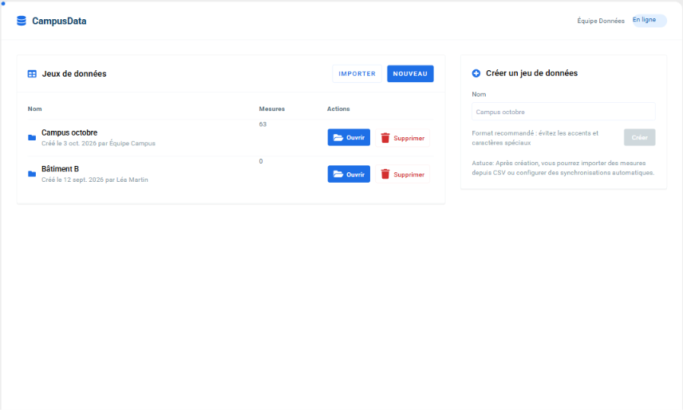
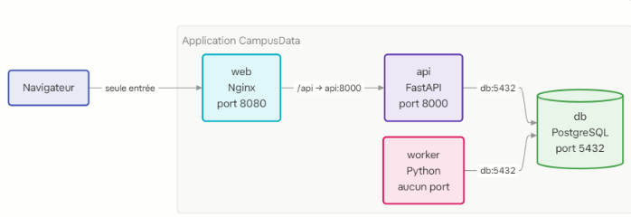

# Dossier de conception - équipe à renseigner

**Membres :** chahnez el bez  **Version du dossier / commit :** à renseigner.
**Date de revue :** à renseigner. **Relecteur :** à renseigner.

Cette trame se complète dès S1 puis évolue avec les décisions réellement prises.
Remplacer les consignes par vos réponses ; conserver les limites utiles.
Ne pas recopier tout l’énoncé : expliquer son application à votre réalisation.

## 1. Besoin et utilisateurs

## 1. Le besoin en cinq phrases

 L'équipe data du campus utilise l'application CampusData pour suivre la qualité de l'air dans les salles.
 Aujourd'hui, les fichiers disponibles sont recopiés à la main dans un tableur ce qui entraine  des erreurs et des doublons.
 Elle dépose un fichier de mesures dans l'application, qui vérifie chaque ligne, signale celles qui sont refusées avec la raison, puis affiche des indicateurs par salle (moyenne, minimum, maximum).
 Il faut conserver les jeux de données, l'historique des dépôts avec leur résultat, les mesures valides et les lignes rejetées avec leur motif, même après un redémarrage du service.
 Sont exclus du projet : la connexion des utilisateurs, l'intelligence artificielle et l'affichage en temps réel.
 ## 2. Scénario de démonstration

1. Ouvrir l'application  sans aucun jeu de données.
2. Créer un jeu de données (« Campus novembre ») et vérifier qu'il apparaît dans la liste avec 0 mesure.
3. Déposer `mesures-avec-erreurs.csv` et attendre que le statut passe de pending à succeeded.
4. Lire le résultat : 4 mesures acceptées, 7 lignes rejetées avec leur raison, 1 doublon.
5. Consulter les indicateurs par salle (CO₂ moyen, min, max) et les filtrer par salle ou par période.
6. Redéposer le même fichier et constater qu'aucune mesure n'est ajoutée une seconde fois.

## 2. Backlog et critères d’acceptation

## 2. Backlog et critères d'acceptation

| ID | En tant que… je veux… afin de… | Priorité | Étant donné / Quand / Alors | Responsable | Test/preuve |
|---|---|---|---|---|---|
| US01 | En tant que membre de l'équipe data, je veux créer un jeu de données afin de regrouper des mesures. | Haute | **Étant donné** qu'aucun jeu « Campus octobre » n'existe, **quand** je le crée, **alors** il apparaît dans la liste. **Critère négatif :** si le nom est déjà utilisé, la création est refusée avec le code 409. | Membre A | Capture de la liste + requête qui renvoie 409 |
| US02 | En tant que membre de l'équipe data, je veux lister et ouvrir les jeux afin de savoir ce qu'ils contiennent. | Moyenne | **Étant donné** que des jeux existent, **quand** j'ouvre la liste, **alors** chaque jeu affiche son nombre de mesures. **Critère négatif :** si j'ouvre un jeu inconnu, la réponse est 404. | Membre B | Capture de la liste + requête qui renvoie 404 |
| US03 | En tant que membre de l'équipe data, je veux supprimer un jeu afin de retirer des données devenues inutiles. | Moyenne | **Étant donné** qu'un jeu contient des mesures, **quand** je le supprime et que je confirme, **alors** le jeu et ses mesures disparaissent. **Critère négatif :** si je ne confirme pas, rien n'est supprimé. | Membre A | Capture de la confirmation + liste après suppression |
| US04 | En tant que membre de l'équipe data, je veux déposer un fichier CSV afin d'alimenter un jeu sans recopier à la main. | Haute | **Étant donné** qu'un jeu existe, **quand** je dépose un CSV, **alors** l'API répond 202 et le dépôt est enregistré avec le statut `pending`. **Critère négatif :** si le jeu n'existe pas, le dépôt est refusé (404). | Membre B | Requête curl avec réponse 202 + statut `pending` |
| US05 | En tant que membre de l'équipe data, je veux voir mon dépôt traité afin de savoir s'il a réussi. | Haute | **Étant donné** un dépôt `pending`, **quand** le worker l'a traité, **alors** son statut est `succeeded` ou `failed`. **Critère négatif :** `en-tete-invalide.csv` donne `failed` avec le message « Invalid header » et 0 mesure. | Membre A | Statut visible avant/après + résultat des 3 fichiers de test |
| US06 | En tant que membre de l'équipe data, je veux voir les lignes rejetées et leur raison afin de corriger mes fichiers. | Haute | **Étant donné** le dépôt de `mesures-avec-erreurs.csv`, **quand** il est traité, **alors** 4 lignes sont acceptées, 7 sont rejetées et la raison de chaque rejet est affichée. **Critère négatif :** une ligne invalide n'est jamais enregistrée comme mesure. | Membre B | Capture de la liste des rejets (7 lignes + raisons) |
| US07 | En tant que membre de l'équipe data, je veux redéposer un fichier sans doublon afin d'éviter de compter deux fois la même mesure. | Haute | **Étant donné** que `mesures-salles-2026-10-05.csv` a déjà été déposé, **quand** je le redépose, **alors** il y a 0 acceptée, 63 doublons et le jeu contient toujours 63 mesures. **Critère négatif :** aucune mesure n'est ajoutée deux fois. | Membre A | Résultat du 2ᵉ dépôt + compteur du jeu à 63 |
| US08 | En tant que membre de l'équipe data, je veux consulter les indicateurs par salle afin d'analyser la qualité de l'air. | Haute | **Étant donné** un jeu avec des mesures, **quand** je consulte les indicateurs, **alors** je vois la moyenne, le min et le max du CO₂ par salle, filtrables par salle et par période. **Critère négatif :** un filtre sans aucune mesure ne renvoie aucun indicateur, sans erreur. | Membre B | Capture des indicateurs avec et sans filtre |
| US09 | En tant que membre de l'équipe data, je veux relancer un dépôt échoué afin de le retraiter après correction. | Moyenne | **Étant donné** un dépôt `failed`, **quand** je le relance, **alors** il est de nouveau traité. **Critère négatif :** relancer un dépôt qui n'est pas `failed` est refusé. | Membre A | Relance d'un `failed` (acceptée) et d'un `succeeded` (refusée) |
| US10 | En tant que membre de l'équipe data, je veux compter sur un service fiable afin de ne pas perdre mes données. | Haute | **Étant donné** des jeux et des mesures enregistrés, **quand** le service est redémarré, **alors** toutes les données sont toujours là. | Membre B | Compteurs avant/après redémarrage |

### Tâches par US

Une tâche n'est terminée qu'après observation de son résultat et revue par l'autre membre du binôme.

| US | Réalisation | Validation | Documentation |
|---|---|---|---|
| US01 | Permettre la création d'un jeu avec un nom unique. | Créer un jeu, puis tenter de recréer le même nom et observer le 409. | Noter l'exemple de requête et les codes de réponse. |
| US02 | Afficher la liste des jeux avec le nombre de mesures, et l'ouverture d'un jeu. | Vérifier le compteur, puis ouvrir un jeu inexistant et observer le 404. | Noter les routes de consultation. |
| US03 | Suppression d'un jeu avec confirmation, et de ses mesures. | Annuler la confirmation (rien ne change), puis confirmer et vérifier que les mesures ont disparu. | Noter que la suppression est définitive. |
| US04 | Route de dépôt qui enregistre le fichier et répond 202 avec le statut `pending`. | Déposer un CSV et observer le 202 ; tester un jeu inconnu. | Noter un exemple de requête curl. |
| US05 | Le worker traite les dépôts `pending` et fixe le statut final. | Déposer les 3 fichiers de test et comparer aux résultats attendus (63 / 4-7-1 / Invalid header). | Décrire le cycle `pending` → `succeeded` ou `failed`. |
| US06 | Enregistrer chaque ligne rejetée avec sa raison et les compter. | `mesures-avec-erreurs.csv` donne 7 rejets, chacun avec une raison lisible. | Lister les raisons de rejet possibles. |
| US07 | Détecter les mesures déjà présentes et les compter comme doublons. | Redéposer le fichier de référence et obtenir 0 acceptée, 63 doublons, 63 mesures au total. | Expliquer ce qui définit un doublon (voir la conception détaillée). |
| US08 | Calcul moyenne, min, max par salle avec filtres salle et période. | Comparer les valeurs à un calcul fait à la main sur le fichier de référence ; tester un filtre vide. | Noter les paramètres de filtre. |
| US09 | Route de relance, autorisée seulement pour un dépôt `failed`. | Relancer un `failed` (accepté) et un `succeeded` (refusé). | Noter la règle et le code de refus. |
| US10 | Stocker les données de façon persistante. | Redémarrer l'application et vérifier que les compteurs sont identiques. | Noter la procédure de redémarrage utilisée pour le test. |

## 3. Maquettes et interactions

### Écran 1 : liste des jeux de données

### Écran 2 : un jeu de données (dépôts, lignes rejetées, indicateurs)

## 4. Architecture et flux
## Modèle de données

### Table DATASET (un jeu de données)

| Colonne | Type | Obligatoire | Contrainte |
|---|---|---|---|
| id | uuid | oui | PK (clé primaire) |
| name | varchar | oui | UK (unique : un nom déjà utilisé est refusé, 409) |
| owner | varchar | à vérifier | |

### Table INGESTION (un dépôt de fichier CSV)

| Colonne | Type | Obligatoire | Contrainte |
|---|---|---|---|
| id | uuid | oui | PK |
| dataset_id | uuid | oui | FK vers DATASET.id |
| status | varchar | oui | pending, succeeded ou failed |
| rows_accepted | int | oui | nombre de lignes acceptées |
| (autres colonnes : rejetées, doublons, message…) | à vérifier | | |

### Table MEASUREMENT (une mesure valide)

| Colonne | Type | Obligatoire | Contrainte |
|---|---|---|---|
| id | bigint | oui | PK |
| room | varchar | oui | |
| measured_at | timestamptz | oui | |
| co2_ppm | int | à vérifier | |
| temperature_c | à vérifier | à vérifier | |
| humidity_pct | à vérifier | à vérifier | |
| (dataset_id, ingestion_id) | à vérifier | | FK, car le schéma indique « reçoit » et « a inséré » |

**Unicité probable pour les doublons :** (dataset_id, room, measured_at) doit être unique. Vérifiez-le dans le schéma.

### Exemples de valeurs

| Colonne | Exemple valide | Exemple invalide |
|---|---|---|
| co2_ppm | 612 | abc |
| temperature_c | 21.5 | abc |
| humidity_pct | 45 | abc |

Les bornes (par exemple une humidité de 150 % ou un CO₂ négatif) sont à lire dans la conception détaillée : ce document fait foi.

### Les trois cas à distinguer

| Cas | Exemple | Ce qui se passe |
|---|---|---|
| Ligne invalide | co2_ppm = abc | la ligne est rejetée et comptée ; le dépôt continue |
| Fichier invalide | en-tête faux | le dépôt passe à `failed` ; aucune mesure n'est insérée |
| Doublon | même salle, même heure | la ligne est ignorée et comptée ; ce n'est pas une erreur |

## 5. Données et contrat
## 5. Contrat HTTP

### Routes techniques (déjà dans le starter)

| Méthode | Chemin | Entrée | Succès | Erreurs possibles |
|---|---|---|---|---|
| GET | /health/live | aucune | 200 `{"status": "ok"}` | aucune (ne dépend pas de la base) |
| GET | /health/ready | aucune | 200 `{"status": "ready"}` | 503 `{"detail": "Database unavailable"}` |
| GET | /api/version | aucune | 200 `{"version": "dev"}` ou la version du build | aucune |

### Routes métier (préfixes /api/datasets et /api/ingestions)

| Méthode | Chemin | Entrée | Succès | Erreurs possibles |
|---|---|---|---|---|
| POST | /api/datasets | nom du jeu | 201 | 409 (nom déjà utilisé) |
| GET | /api/datasets | aucune | 200 (liste avec nombre de mesures) | |
| GET | /api/datasets/{id} | id du jeu | 200 | 404 |
| DELETE | /api/datasets/{id} | id du jeu | à relever | 404 |
| POST | à relever | jeu + fichier CSV | 202 (`pending`) | 404 |
| GET | /api/ingestions/{id} | id du dépôt | 200 | 404 |
| POST | à relever | id du dépôt | à relever | 409 (dépôt non `failed`) |
| GET | à relever | filtres salle et période | 200 | 404 |

Diagramme 1 – Composants et ports

![Séquence d’un dépôt] (Séquence d’un dépôt.png)
## 6. Découpage du code et transactions

| Module | Responsabilité | Dépendances | Invariant/commentaire important | Test associé |
|---|---|---|---|---|
| À renseigner | Une responsabilité précise | Modules utilisés | Règle protégée | Scénario |

Préciser le responsable du **commit**, le **rollback**, la fermeture des sessions,
le **verrou de ligne** et la sérialisation. Décrire l’initialisation explicite et
la limite de create_all face à une évolution de schéma.

## 7. Décisions argumentées

| Décision | Option retenue | Alternative étudiée | Motif concret | Conséquence/limite | Preuve ou référence |
|---|---|---|---|---|---|
| À renseigner | Choix | Alternative | Contrainte satisfaite | Coût ou risque accepté | Référence |

Une préférence seule ne justifie pas un choix. Relier la décision au temps,
au contrat, à la reproductibilité ou au comportement observé.

## 8. Risques et mesures

| Risque | Effet utilisateur | Détection | Mesure prévue | Limite restante |
|---|---|---|---|---|
| Panne API | À compléter | À compléter | À compléter | À compléter |
| Panne DB | À compléter | À compléter | À compléter | À compléter |
| Perte du nœud | À compléter | À compléter | À compléter | À compléter |
| **Secret** exposé | À compléter | À compléter | À compléter | À compléter |
| Ressource cloud oubliée | À compléter | À compléter | À compléter | À compléter |

## 9. Validation croisée

Noter qui a relu le dossier, quelles ambiguïtés ont été trouvées et corrigées.
Identifier les différences entre conception initiale et réalisation finale.
Conserver les questions non résolues et leurs effets, sans les présenter comme validées.

## Exemple de justification à adapter

**Exemple de forme, à relier à votre réalisation :** « Nous utilisons une session
par requête pour séparer les transactions des utilisateurs. La dépendance ferme
la session même si une erreur remonte. Nous vérifions que l’ingestion est
idempotente en redéposant le même fichier puis en relisant le nombre de mesures. »

Ajoutez le nom de votre module, le test correspondant et la limite observée.
Ne reprenez pas cette explication si votre implémentation utilise une autre
organisation : décrivez alors son fonctionnement réel.
